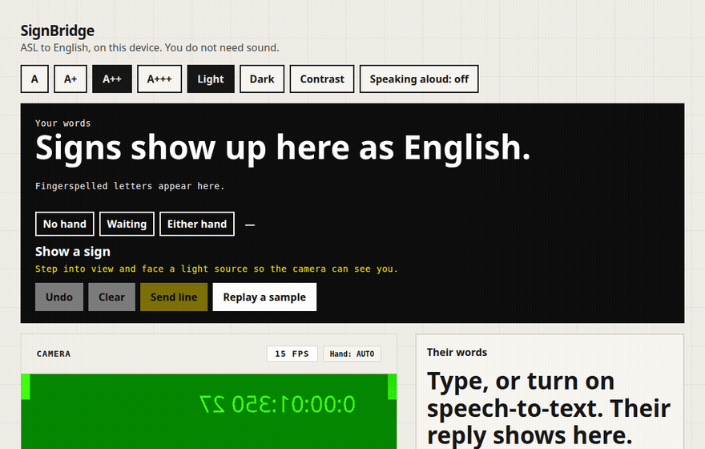

# SignBridge

SignBridge turns one American Sign Language gloss at a time into English text. The camera and the recognizer stay on the device. Nothing is uploaded. Only ASL is implemented. A later sign language would plug in at `src/languages/aslEnglish.ts`.

The recognizer still reads one gloss at a time. On-device rules then turn the glosses you commit into a short English sentence, and the glosses stay visible under it. That is word order and a few fixed phrases, not full ASL grammar.

The public demo is [https://rjb07.github.io/sign-bridge/](https://rjb07.github.io/sign-bridge/). It appears after a push to `main` once GitHub Pages is set to deploy from GitHub Actions. `CONTRIBUTING.md` has that one-time setting.



## Quick start

```bash
npm install
npm test
npm run dev
```

Open the URL Vite prints.

1. Allow the camera, or press **Replay a sample**. That runs a real held-out PopSign clip through the same classifier. The first samples are hello, thank you, and please.
2. The large line is an English sentence such as “Hello.” The glosses stay underneath. **Undo** removes the last gloss (Backspace does the same when you are not typing). Tap a gloss to remove it. **Send line** puts the sentence in the conversation and leaves the glosses on that message.
3. **Your signs** saves the last sign under a label you choose. It stays in this browser, video is not stored, and a close match can replace the shared guess.
4. A hearing person types in **Their words**. Speech-to-text is optional. The reply is shown as text. **Speaking aloud** stays off until you turn it on for them.
5. Caption size, and light, dark, and high-contrast themes, are in the top bar. On a phone the caption stays above the camera.

Install: in Chrome, Edge, or Safari, use **Install SignBridge** or **Add to Home Screen**. The first visit has to be online so the app can store the recognizer and the MediaPipe tracker. After that, captions, replay, and the camera work offline. The page uses system fonts, so text does not wait on Google.

```bash
npm run build          # static site plus the service worker
npm run test:e2e       # two-sign replay, clear, undo, typed reply, contrast theme, offline reload
```

`npm run build` checks `SIGNATURE.json` first. That file has to keep the lead attribution. End-to-end tests need Chrome (`CHROME_PATH` if it is not on the default path). GitHub Actions runs the unit tests, the Python split checks, the build, and the browser test. It does not download PopSign.

## Using it

The English sentence is the largest text on the screen. The gloss chips under it are what the recognizer committed. Sound is off until you turn on “Speaking aloud” for a hearing person. The guess shown while the hand is still moving uses one ensemble member and no mirror, and it is not recomputed on every camera frame, so a low-end phone can keep up. The word that is actually added uses the full model, then your saved signs if one is very close. This model file does not mirror the clip a second time. Camera frames are not uploaded. Speech to text, off until you press it, sends microphone audio to the browser’s speech service and not to SignBridge. A meter and a short “Added …” line mark the commit. If the hand is missing, too close, or out of frame, the caption says so.

## What you should expect

The shipped recognizer is four landmark transformers (width 192, 3 layers, float16 weights) averaged together, plus a small hand-shape embedding. Each frame is the hands relative to the nose, wrist-centered hand shape, arm pose, frame-to-frame motion, the wrist and fingertips relative to the lips, eyes, and cheeks, and five fingertip curls. Validation and test are PopSign’s official game signer split (8 and 8 signers, at most 20 clips per gloss). Training is the 64-per-gloss game core from the other 31 signers, plus every non-game training clip whose signer is outside those 16 validation and test signers. One of those non-game signers is not in the 31, so the training file has 32 signers. No validation or test signer is in training.

| | |
| --- | --- |
| Gloss vocabulary | **250** English glosses, the full PopSign / Google ASL Signs list |
| Train / val / test clips | 40,139 / 4,623 / 4,540 |
| Test top-1 | **56.9%** |
| Test top-5 | **79.7%** |
| Macro recall | 57.0% |
| Chance top-1 | 0.4% |
| Live gate on test | 78.4% precision when it commits, on 53.3% of clips |

The stored test scores are 0.5694 top-1 and 0.7974 top-5. Validation top-1 on the unchanged 4,623 clips is 57.4%, and validation top-5 is 81.8%. Two members use the shoulder-scaled hand shape and two use the palm-scaled shape. Their logits are averaged with validation weights 1, 1, 1.5, and 1. The previous shipped file, three members, scored 0.5676 and 0.7974 on these same 4,540 clips. A five-member blend was 57.4% on validation as well, within a tenth of a point of this four-member set, so the smaller file shipped. Int8 weights barely changed one member’s validation score and do not shorten the browser matmul. Cutting the feed-forward width from 480 to 240 dropped that member from 52.8% to 40.5% validation top-1. The commit path is a blocked matrix multiply in the same JavaScript the page already runs, so a phone without WebGPU still uses it, and nothing new has to be downloaded for offline use. Mirror test-time augmentation stays off. The file divides logits by a temperature of **1.057** before the softmax. That value was fit on the validation clips and does not change which gloss wins. One member previews in 26 ms and the four-member commit takes 100 ms. The attention dots use the same multi-output loads. After that, mirror averaging of these four members takes 194 ms, five members take 122 ms, and six take 147 ms. The best five-member weight set on validation is 57.4%, the same tenth of a point as the shipped four, so the test list was not opened for it. A width-256, 3-layer member with the feed-forward width at 640 takes 41 ms, and two of them take 84 ms. One shoulder-scaled member of that size finished at 51.3% validation top-1 (51.7% with mirror averaging). One palm-scaled member finished at 49.8% (50.1% with mirror averaging). The best mix of those with the existing members, still under 130 ms, is 57.4% validation top-1, the same as the shipped four. The test list was not opened.

When the gate will not add a word, three large buttons offer the top guesses. Tap the one you signed. The previous model’s weakest validation glosses were near neighbors such as pen/pencil, cheek/eye, and mouth/lips. Those distances are what the extra face features are for.

Quick phrases sit under the caption. Hello, thank you, please, yes, no, water, potty, and sick are in the 250 and can also be recognized from the camera. Help, sorry, name, doctor, and bathroom are not. Tap one of those to put the English word on screen, or hold still and fingerspell it. The 250 uses potty, not bathroom. Google ASL Signs is the same 250 under CC BY 4.0, so it does not add these words. The permissive way to sign them is fingerspelling: the MIT still-frame letter model already in the app, or the Google ASL Fingerspelling landmarks (treat as CC BY 4.0, confirm the data page) once a Kaggle token is set. ASL Citizen and WLASL cover a wider vocabulary, and their licenses do not allow shipping a model trained on them.

A faster three-member student (width 160, 2 layers) was distilled from this ensemble so mirror averaging could fit in 130 ms. On validation it scored 53.7% top-1 and 80.9% top-5. Mirror averaging was 53.5% top-1, so it was not used. Commit time without it is 62 ms. Because validation top-1 is below 55.5%, the test list was not scored again and this file stays. The weak glosses (finger, pen, mouth, go, read, and others) got a wider speed warp and a shorter time crop during that distillation. Details: `training/metrics/fast160-val.json` and `training/metrics/fine-val-worst.json`.

The same 192×3 network was retrained with palm-sized hand shape, left hands mirrored into a right-hand frame, a small 3D camera rotation, a random hand-versus-body scale, and a frame-rate bend. On its own, that ensemble is **53.8%** validation top-1 without a mirrored second view and **54.1%** with one (top-5 **80.7%**). Below 55.5%, so that file was not scored on the test list by itself. Two of its members are in the shipped blend above. Details: `training/metrics/signer192-val.json` and `training/metrics/blend4-test.json`.

An earlier model was 50.6% top-1 and 75.1% top-5 on 2,744 test clips drawn from a partial shard download. That list is smaller than these 4,540 clips, so it is not a paired comparison. A 32-gloss model earlier on this branch scored 59.1% top-1. That number is not comparable either: this model chooses among 250 signs. Chance falls from 3.1% to 0.4%. Conversational glosses are in the 250. Per-class recall on this test list: hello 44% (18 clips), thank you 81% (16), please 75% (16), yes 47% (17), no 58% (19), water 78% (18), mom 56% (16), dad 53% (17). **Help is not in this 250-sign list.**

Focus-gloss precision and recall for this blend: `training/metrics/blend4-test.json`. The full 250-class table in `training/metrics/asl_en_metrics.json` is the earlier 56.7% file.

Fingerspelling is a separate static network trained on the MIT dataset `sid220/asl-now-fingerspelling` (A–Z, including J and Z). Filename-hash holdout top-1 is **92.3%** (222 test frames). J recall 91% (11 frames), Z recall 100% (10 frames). **Signer ids are not in that dataset, so this letter number is not signer-independent.** Details: `training/metrics/fingerspelling_metrics.json`.

Live output is suppressed unless the score clears a threshold picked on the validation signers, including a per-class floor when the model file has one. A gloss is added once per motion segment. A brief slowdown, then motion again, starts the next sign, so two words in a sentence do not need a full pause. If that gate does not commit, the top three words stay on screen as large buttons and one tap adds the word you meant. **Send line** commits the caption into the conversation. Speaking aloud, if you turned it on, reads that line to the hearing person. It does not run by default.

Fingerspelling letters A–Z, including J and Z, come from a static landmark network. See the metrics file for the holdout caveat.

## Dataset and license

Training uses PopSign ASL v1.0 game frames plus non-game frames whose signers are outside the game validation and test partitions, CC BY 4.0, via the frame release [`sign/popsign-images`](https://huggingface.co/datasets/sign/popsign-images). Cite Starner et al., PopSign ASL v1.0 (2023). Landmark files are derived and are not a way to identify the signers.

The download list is `training/download_popsign.py`. Shards are chosen so each trained gloss also appears in the official validation and test partitions. `training/splits.py` stops the run if any signer id appears in more than one partition.

Not used for the model, and why:

- **WLASL / MS-ASL** — video rights are research-only. The WLASL index JSON in this repo is not training data.
- **ASL Citizen** — non-commercial research license; the data and modifications may not be redistributed.
- **FLEURS-ASL** — sentence translation, CC BY-SA, wrong task for a small isolated-gloss model.
- **Google Isolated Sign Language Recognition (Kaggle)** — same 250 glosses, already landmarks, CC BY 4.0. Not downloaded for this model. See below.

## More data, when a Kaggle token exists

`docs/KAGGLE_DATASETS.md` lists the two downloads that are worth plugging in later: the full Google ASL Signs landmark release (same 250 glosses, native frame rate, many more examples per sign) and the Google ASL Fingerspelling release (signer ids and the motion of J and Z). ASL Citizen and WLASL are not on that list.

## Retrain

```bash
python3 -m venv .venv && source .venv/bin/activate
pip install -r training/requirements.txt
# Linux also needs libEGL and libGL for MediaPipe
PYTHONPATH=training python training/scan_popsign.py
PYTHONPATH=training python training/build_cache.py --train-cap 200 --nongame-cap 100000 --core-only --with-nongame --workers 3
PYTHONPATH=training python training/featurize_fine.py --cache training/cache --index index.jsonl
PYTHONPATH=training python training/featurize_signer.py --cache training/cache --index index.jsonl
PYTHONPATH=training python training/train_sequence_model.py --cache training/cache --index index.jsonl --seq-subdir seq-signer --feature-layout signer --shape-embed --augment signer --hidden 192 --layers 3 --ff 480 --epochs 36 --patience 8 --warmup 3 --batch-size 128 --seeds 0,1,2 --label-smoothing 0.05 --experiment signer192 --artifact-dir training/artifacts/signer192 --hold-test --skip-student --latency-commit-ms 130 --latency-preview-ms 50 --resume
PYTHONPATH=training python training/train_sequence_model.py --cache training/cache --report-test --artifact-dir training/artifacts/signer192 --feature-layout signer
```

`--hold-test` picks mirror augmentation, float16, and a student on validation only. `--report-test` scores that selection on the test list once. The signer layout is the same 389-d vector as `seq-fine`, except the wrist-centered hand shape is scaled by palm size instead of shoulder width, and a left hand is still mirrored into a right-hand frame. Its augmentation adds a small 3D camera rotation, a random hand-versus-body scale, and a frame-rate bend. The 56.7% model used shoulder-scaled shape (`experiment fine192`). The 55.2% model used the 294-d features without face offsets (`experiment core64-rich192`). The 53.9% model used the 273-d features, width 128, and 2 layers (`experiment core64-nongame`). `--with-nongame` keeps that validation and test list and adds non-game training clips only. Replace the shipped file only when the signer-disjoint test top-1 beats the file already there and the commit stays under about 130 ms.

Extraction writes `training/cache/` (gitignored). The trainer compares a three-seed ensemble with a smaller distilled student, with and without mirror test-time augmentation, and it keeps float16 weights when the validation top-1 drop stays within half a point. It replaces `public/models/asl-en-sequence.json` only when the signer-disjoint test top-1 is higher than the file already there and the browser latency check passes. Either way it writes `training/metrics/asl_en_run.json`.

When a run is shipped it also writes:

- `public/models/asl-en-sequence.json` — weights the app loads
- `public/models/demo-clips.json` — held-out replay clips
- `public/models/parity.json` — logits the browser port must match
- `training/metrics/asl_en_metrics.json`

The shipped vocabulary is already the full 250 PopSign glosses. `training/scan_popsign.py` indexes every game and non-game shard on `sign/popsign-images` with range requests, and `training/build_cache.py` downloads frames only for the selected clips. The number above is that full-catalog game test list. The Kaggle landmark release in `docs/KAGGLE_DATASETS.md` is still the native-frame-rate set and still needs a token.

## Layout

- `src/tracking/MediaPipeTracker.ts` — camera and Holistic landmarks
- `src/recognition/` — features, sequence model, live segmenter, fingerspelling
- `src/textAssembly/SignTextAssembler.ts` — phrase buffer
- `src/textAssembly/glossEnglish.ts` — gloss sequence to a short English sentence
- `src/personalize/personalSigns.ts` — signs saved in the browser
- `src/languages/aslEnglish.ts` — the only language pack
- `training/` — download, landmark extraction, training
- `docs/AUDIT.md` — architecture notes, including why there is no database

## Limits

- The vocabulary is the 250 PopSign glosses. Help is not one of them. Two-handed signs are represented when both hands are in frame, but PopSign is mostly one-handed phone signing.
- Training clips are short and about 5 frames per second.
- Fingerspelling holdout is not signer-independent.
- Offline use still needs the first online load, or a build that already contains `public/vendor/mediapipe/` and `public/models/holistic_landmarker.task`.
- The app JavaScript does not load TensorFlow.js. Camera tracking is MediaPipe Holistic, about 14 MB of WASM plus the task file, cached by the service worker.
- Do not treat the confidence percentage as a clinical measurement.

## Database

None. Samples the user imports stay in `localStorage`. The transcript is not saved. Details are in `docs/AUDIT.md`.
